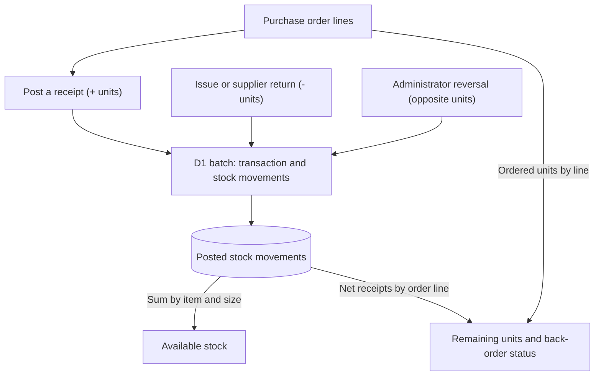
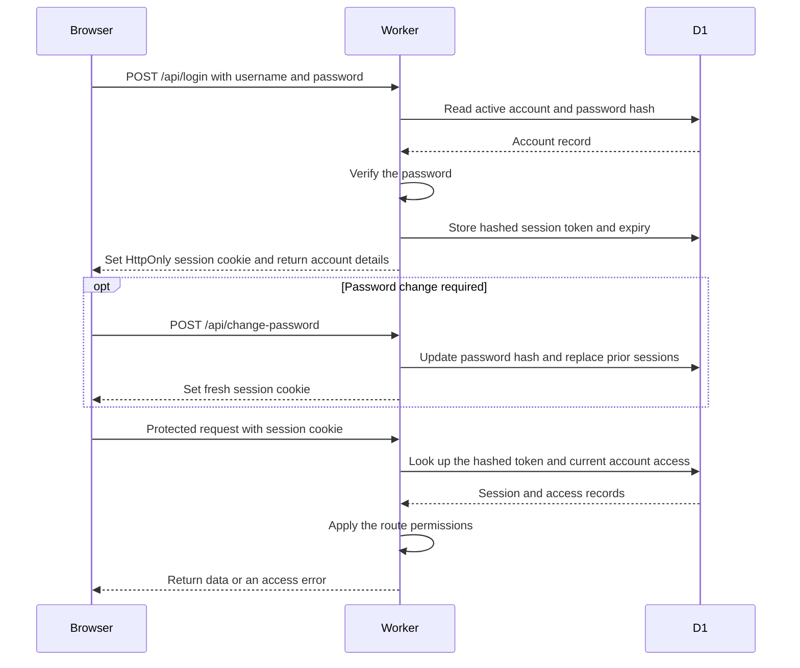
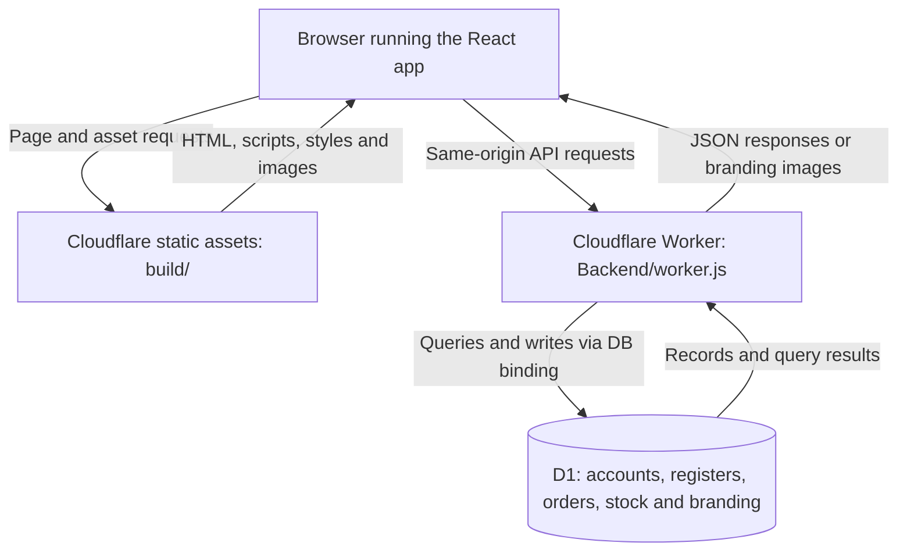
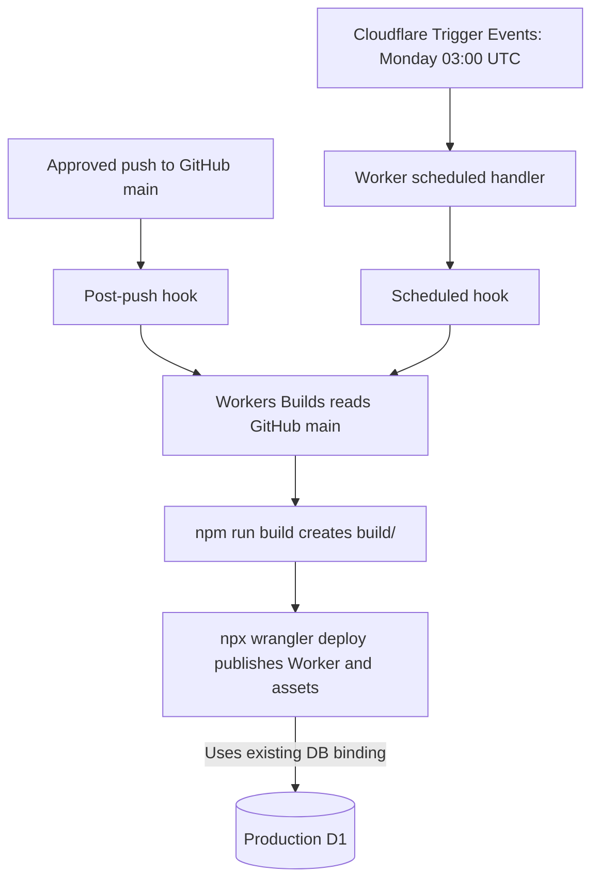

# RAFACSIMS

RAFACSIMS, called CAT SIMS in the design documents, is a squadron stores application for the RAF Air Cadets. It tracks uniform stock from supplier orders and deliveries through issue to cadets, returns to suppliers and stock corrections.

The project rebuilds the workflows of the SIS V1 PHP/MySQL reference as a React application backed by Cloudflare Workers and D1. The local `V1/` copy and its SQL exports informed the design and are excluded from Git and deployment. This release starts with fresh operational records. Legacy migration, CSV exchange, cadet handbacks and current holdings are outside its scope.

- [Design and business rules](Documentation/DESIGN.md)
- [Release checklist and development priorities](Documentation/TODO.md)
- [Repository and post-push requirements](AGENTS.md)

Jump to [stores workflows](#stores-workflows), [request and data flow](#request-and-data-flow), [Cloudflare deployment](#cloudflare-deployment), [development and verification](#development-and-verification) or the [API reference](#api).

## Stores workflows

1. Administrators set up suppliers, cadets, catalog items and sizes. Administrators manage every login in **Staff Accounts**, using a username, temporary password, role and stores permissions.
2. Staff or administrators raise a purchase order for one supplier. Receiving stock updates the size balances. A partial delivery creates a back order for the remainder, and later deliveries close the same back order.
3. Staff or administrators issue stock to a cadet or return stock to a supplier. Stock Management shows availability and movement history by size. Cadet Kit shows issue history and totals for unreversed issues.
4. Administrators can cancel eligible unreceived orders or reverse posted movements with a reason. The originals and the corrections remain available in history. Transaction details support printing.

The dashboard links operational users to outstanding purchase orders and back orders. About Us is shown after sign-in and any required password change.

### How transactions change stock

A purchase order records what is expected. Stock changes when a receipt, issue, supplier return or reversal posts movements to the ledger.

The remaining quantity is the ordered quantity minus net receipts. D1 rejects movements that would make a size balance negative or take net receipts outside the ordered quantity. The same batch updates the purchase order when a receipt is posted or reversed. A partial receipt creates one back order per purchase order. Subsequent receipts use that same reference. See the [worked stock example](Documentation/DESIGN.md#worked-example-for-one-uniform-size).

### Account access

| Option | Access |
| --- | --- |
| User | Dashboard and account controls. Administrators create these accounts in Staff Accounts. |
| Issue Kit | Issue uniform to cadets and view Cadets and Cadet Kit. |
| Return Kit | Post and review returns to suppliers. |
| Stores Demands | Raise and edit eligible purchase orders, receive deliveries and manage back orders. |
| Admin | All workflows, register maintenance, staff account management, branding, cancellations and reversals. |

Administrators can combine the three stores permissions for a User. Any stores permission grants access to Stock Management. The Worker checks permissions on every protected request. Newly created or reset accounts must replace their temporary password before using these features.

### Sign-in and session checks

The diagram follows a successful sign-in. On page load, the browser can restore an existing session through `GET /api/session`, which returns `user: null` if the session is missing or expired.

## Architecture and repository layout

The source is grouped by purpose. Build tooling and both Wrangler entry configurations live at the repository root. React 19 and Material UI 7 provide the interface. esbuild bundles scripts, styles, fonts and imported images into `build/` with content-hashed filenames. Wrangler deploys the Worker and the static assets together. Requests to `/api/*` reach the Worker first. Other paths use the asset binding and the single-page application fallback.

### Request and data flow

### Source files

| Location | Contents |
| --- | --- |
| [Frontend/](Frontend/) | Browser entry, React pages, CSS, HTML template and browser assets |
| [Backend/](Backend/) | Worker entry, API handlers, D1 schemas and backend tests |
| [Cloudflare/](Cloudflare/) | Static asset headers |
| [Documentation/](Documentation/) | Design, release checklist and script notes |
| Repository root | README, project instructions, build script, npm manifests and Wrangler configs |

The Worker initializes missing tables on API access. D1 stores accounts in `staff` with a username, password hash, role and permissions. Keep the existing `DB` binding and D1 database ID to preserve accounts and operational records. Stock availability comes from posted movements. Database constraints and batched writes protect stock and order remainders. Request IDs support recovery when a posting response is interrupted.

## Cloudflare deployment

| Workers Builds setting | Value |
| --- | --- |
| Repository | `TMBar-Dev/RAFACSIMS` |
| Production branch | `main` |
| Shared preview branch | `preview` |
| Root directory | Repository root |
| Build command | `npm run build` |
| Deploy command for the original account | `npx wrangler deploy` |
| Deploy command for the second account | `npx wrangler deploy --config wrangler.other.jsonc` |
| Worker and D1 database name | `rafacsims` |

Set the Workers Builds root to the repository root. Both Wrangler configs point to `Backend/worker.js`, and the deployment continues to publish `build/`. Clear the former `client/` setting if it is still present. Both Wrangler configs set the asset binding, so omit a separate `--assets` argument.

Each Cloudflare account has its own D1 database. `wrangler.jsonc` points to the original database. `wrangler.other.jsonc` points to the second account's database. Both expose the binding as `DB`. Set the second Worker's deploy command explicitly so Wrangler selects its database. The deploy identity needs access to the Worker and its configured D1 database.

**Public files.** The build copies the favicon, Apple touch icon, two app icons, manifest and robots file from `Frontend/`, and the `_headers` file from `Cloudflare/`, alongside the bundled app. The `build/` binding keeps repository files, SQL exports, secrets and `V1/` outside the public asset directory.

### Shared preview

Use `preview` as the long-lived branch for testing in Cloudflare before release. Keep the production branch set to `main`. In the second Cloudflare account, set the Preview command to `npx wrangler preview --config wrangler.other.jsonc`. In the original account, use `npx wrangler preview`. Both use the repository root and `npm run build`.

### Updating an existing database

On the first API request after deployment, the Worker moves the old profile table to `legacy_staff_profiles` and renames the account table to `staff`. The migration preserves passwords, numeric account IDs, active sessions and historical references. Previously linked accounts keep all three stores permissions. Legacy profile rows remain available for historical references.

Record a D1 recovery point before deploying to an existing database. A Worker version from before the migration expects the old database schema. Rolling back to that version therefore also requires a compatible database restore.

### First sign-in

A fresh database starts with no accounts. Open `/api/session` on the deployed Worker to initialise its tables, then provision the first administrator through D1. Insert a username, a password hash, `role = 'admin'` and `must_change_password = 1` into `staff`. Sign in with that account and replace the temporary password. Additional accounts can be created in **Staff Accounts**.

The stored format is `pbkdf2$100000$<salt>$<hash>`. Derive the 32-byte hash using PBKDF2-SHA256 with 100,000 iterations. Generate a random 32-byte salt and convert it to lowercase hex. Encode that hex salt as UTF-8 for PBKDF2, and store the digest in lowercase hex. See the [Worker password implementation](Backend/worker.js).

Existing changed passwords survive redeployment. Sessions expire after 30 minutes of inactivity or 24 hours total. They use Secure, HttpOnly, SameSite browser-session cookies with hashed tokens in D1. Sign out when leaving a shared computer. Password changes and administrator actions such as username or role edits, resets and deactivation revoke affected sessions.

### Weekly and post-push deployment

- **Weekly rebuild.** Set Monday at 03:00 UTC under **Trigger Events** on the existing Worker. Keep cron out of `wrangler.jsonc` so the dashboard owns the schedule. The handler uses the runtime secret `CLOUDFLARE_DEPLOY_HOOK_URL` to rebuild `main`, including weeks with no new commits. The local hook value is kept in the ignored `Documentation/Local/.env.cloudflare-nightly-deploy-hook` file.
- **After an approved push.** Use the separate hook in the ignored `Documentation/Local/.env.cloudflare-deploy-hook` file. Follow the approval and reporting steps in [AGENTS.md](AGENTS.md).

A queued build confirms Cloudflare accepted the request. For a scheduled run, match the build ID in Workers Logs to the result in Workers Builds. Both hooks build the configured branch. A code defect still needs a fix or rollback.

#### Build and deployment flow

## Branding

Administrators can change the system name, short name, About Us, app-bar logo and sign-in cover. The Worker validates uploads before replacing a saved image.

| Image | Formats | File limit | Maximum pixels per side |
| --- | --- | --- | --- |
| Logo | PNG or JPEG | 128 KiB | 1,024 |
| Sign-in cover | PNG or JPEG | 512 KiB | 2,560 |

Browser and home-screen icons use the bundled carton artwork. The ImageGen-produced `stores-cover.jpg` is the default sign-in cover.

Default cover generation prompt

> Photorealistic editorial cover photograph for a modern RAF Air Cadets squadron stores inventory web app. Wide landscape image, a tidy stack of folded plain RAF-blue shirts and dark navy uniform knitwear beside a pair of polished black parade boots on a light utilitarian shelf. Keep the objects grouped to the LEFT with comfortable framing and generous quiet dark slate-blue negative space on the RIGHT for an overlaid sign-in card. Use natural side light, tactile fabric and leather, subtle grain, dark ink-blue and desaturated blue-grey palette. A contemporary product photograph, grounded and recognisably about uniform stores. No people, insignia, logos, badges, weapons, aircraft, lettering or watermarks. No UI in the image.

## Development and verification

Use Node.js 22.12 or later and npm 10.9.2 from the repository root. Regenerate the lockfile with that npm version when changing dependencies.

Material UI uses Emotion for styling.

`npm run dev` provides a frontend-only preview at `127.0.0.1:5173`. Restart it after changing the HTML template or copied public assets. Use the deployed app for Worker and D1 workflows.

- `npm test` runs the Node.js SQLite-backed schema and API tests without writing to live D1. If the shell blocks child processes, use `node --test --test-isolation=none Backend/*.test.mjs` on Node 24.
- `npm audit --package-lock-only` checks dependency advisories without installing packages.
- Cloudflare Workers Builds performs build verification. Use fresh records in the deployed browser to verify the real Worker, D1 and UI together.
- Record source review, dependency audit, Cloudflare build and browser verification separately. See the [release checklist](Documentation/TODO.md).

### Administrator recovery and production checks

Keep two verified administrators on each active database. If one loses access, the other can reset it in **Staff Accounts**. If both are locked out, an authorised D1 operator can use the [password reset helper](Documentation/Scripts/Reset-RafacSimsPassword.ps1) to replace one account's hash, require a password change and revoke its sessions. Verify the database ID first, test the procedure on staging and deliver the temporary password privately. Review recent account and branding events under **Settings**.

The build command runs the schema and API suite and an npm audit before bundling. GitHub Actions runs the same checks. Use the Node version in `.node-version` for both Workers Builds projects. See the [production follow-up checklist](Documentation/TODO.md#production-security-review-follow-up).

## Development focus

Complete owner-led release verification first, including the Monday deployment and a full stores workflow through stock correction. Use pilot feedback to prioritize navigation, forms, interrupted saves and printing. Document D1 recovery and monitoring, then plan the next React and Material UI upgrades separately from feature work. See the [prioritized backlog](Documentation/TODO.md#development-after-release-verification).

## API

Send JSON for `POST` requests with an `Origin` that matches the request URL. Browser requests set this header automatically. Responses use Cache-Control: no-store.

Sign-in failures are limited separately by username and network. IPv6 addresses are grouped by /64. Other write requests have a separate rate limit.

### Sessions and passwords

| Endpoint | Request or result |
| --- | --- |
| `GET /api/session` | Returns the session user, or `{ "user": null }` when signed out. |
| `GET /api/operations/access` | Returns `canOperate: true` and the effective `permissions` array to a ready session with stores access. Returns `401` when signed out or `403` when access is unavailable. |
| `POST /api/login` | Send `username` and `password`. |
| `POST /api/change-password` | Send `currentPassword` and `newPassword`. The Worker revokes prior sessions and issues a fresh one. |
| `POST /api/logout` | Ends the current session. |

The Worker uses Web Crypto PBKDF2 with 100,000 iterations for password hashing to fit the Worker runtime.

### Staff accounts

These routes require an administrator who has completed any mandatory password change.

| Endpoint | Request or result |
| --- | --- |
| `GET /api/staff?after=0` | Lists up to 25 accounts by ID in the `staff` array. Each entry includes an `account` with username, role, permissions, active status, password-change status and creation time. |
| `POST /api/staff` | Send `username`, `password`, `role` and an explicit `permissions` array. Usernames are 2–40 characters and temporary passwords are 6–128 characters. The account must change its password at first sign-in. |
| `POST /api/staff/ID/edit` | Send `username`, `role`, `previousUsername`, `previousRole`, `permissions` and `previousPermissions`. |
| `POST /api/staff/ID/reset-password` | Send the temporary `password`. |
| `POST /api/staff/ID/deactivate` and `POST /api/staff/ID/reactivate` | Send an empty JSON object. |

Use `user` or `admin` for `role`. Permission keys are `issue-kit`, `return-kit` and `stores-demands`. An administrator has all workflow permissions. Pass the returned `nextCursor` as `after` for the next page.

Existing clients can use `/api/users` and its `users` envelope. Older `/api/staff` create requests that omit `permissions` grant all stores permissions, and existing logins need administrator-issued credentials before gaining privileges. Reset unverified credentials and hand the temporary password to the intended account holder before granting access.

### Registers and purchase orders

Users with a stores permission can read active supplier, catalog and variant records. Reading cadets requires Issue Kit. Working with purchase orders requires Stores Demands. Register writes require an administrator.

- **List and detail.** `GET /api/{cadets,suppliers,catalog,variants,purchase-orders}` returns up to 25 `records` and a `nextCursor`. Use `q` for search and `after` for the next page. Append `/ID` for a single `record`.
- **Register filters.** Use `active=1` for pickers. Catalog and variant lists support `supplierId`. Variants also support `itemId`.
- **Register writes.** `POST /api/{cadets,suppliers,catalog,variants}` creates a record. Append `/ID` and send the current `version` from the detail response to edit. A stale version returns a conflict.
- **Order writes.** `POST /api/purchase-orders` accepts `supplierId`, optional `notes` and 1–50 `lines`. Each line has `variantId` and a positive whole `quantity` up to 1,000,000. Append `/ID` and send the current `version` to edit a pending order.
- **Dashboard total.** `GET /api/purchase-orders/summary` returns the count of orders awaiting all or part of their delivery as `pending`.

### Inventory and transaction recovery

Use the corresponding permission for issues, supplier returns, or receipts and back orders. Stock is available with any stores permission. Cancellations, reversals and opening balance history require an administrator.

- **Lists and details.** `GET /api/{receipts,back-orders,issues,supplier-returns,cadet-kit,inventory-stock}` supports search and `/ID` details. Back orders expose `/summary`. Stock details expose `/ID/sizes` and `/ID/movements`. Use `orderId` on receipt history or `cadetId` on issue history.
- **Receiving.** `POST /api/receipts` accepts `orderId`, optional `backOrderId`, optional `notes` and lines with `orderLineId` and `quantity`.
- **Issue and return.** `POST /api/issues` accepts `cadetId`. `POST /api/supplier-returns` accepts `supplierId`. Both accept optional `notes` and lines with `variantId` and `quantity`.
- **Corrections.** Administrators send a `reason` to `POST /api/purchase-orders/ID/cancel` or `POST /api/{receipts,issues,supplier-returns,opening-balances}/ID/reverse`. `GET /api/opening-balances` lists stock adjustments and historical opening balances for administrators. To post an adjustment, send `variantId`, signed whole-unit `quantity`, `reason` and an optional `requestId` to `POST /api/opening-balances`.

For a purchase order create, receipt, issue or supplier return, retry the same data with the same `requestId` to recover the original reference. The author can also use `GET /api/posting-status/{purchase-orders,receipts,issues,supplier-returns}/REQUEST_ID` to check whether the write succeeded. The browser keeps only the pending request ID in the current tab while the outcome is uncertain.

### Branding and settings

| Endpoint | Access and purpose |
| --- | --- |
| `GET /api/branding` and `GET /api/branding/{logo,cover}` | Public display names and images. |
| `GET /api/about` | About Us for signed-in users who have completed any required password change. |
| `GET /api/settings` and `POST /api/settings` | Administrators read or update `name`, `shortName` and `aboutUs`. |
| `POST /api/branding/{logo,cover}` | Administrators upload base64 `content` or send `restore: true` with the previous `revision`. The browser can use the previous image if a replacement fails to render. |
